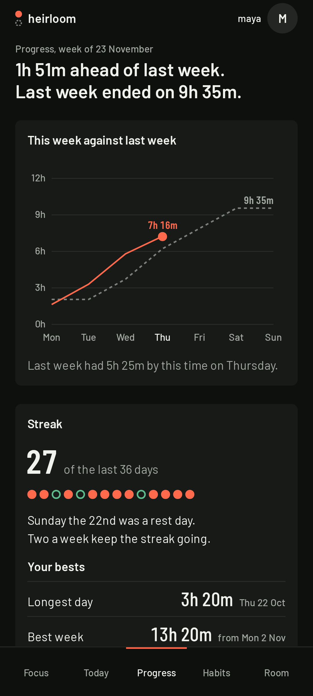
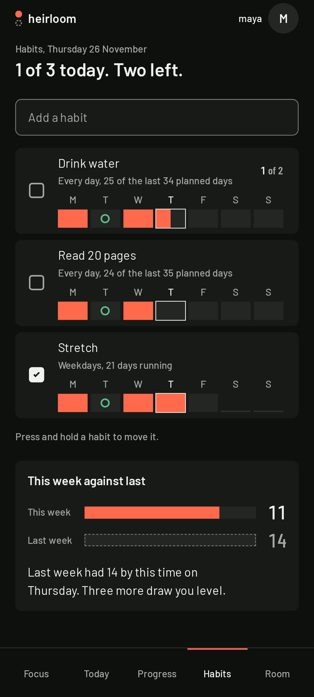
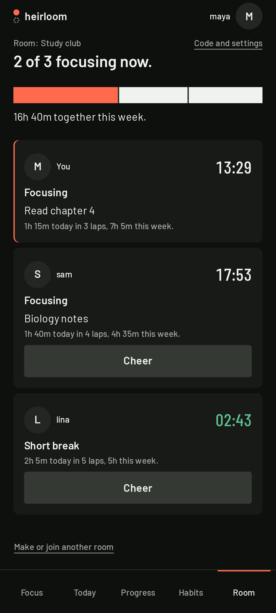

[](https://github.com/ravindu644/heirloom/releases/latest)
[](./LICENSE)

# heirloom

heirloom is a free Pomodoro, tasks and habits app for people who keep meaning to start. You work
in laps of focus, and your own past day runs in the lane beside you, so you always know how today
is going.

It runs on your phone and in your browser, the two in step to the second, and both keep working
with no connection. Your days live on a server that you or a friend runs: one small program and
one file, light enough for an old phone.

## What you get

- **A race against yourself, never anyone else.** Last week's same day runs beside you as a ghost.
  You see how far ahead or behind you are, and what one more lap would do.
- **Tasks that count in laps.** Give a task an estimate, and its bar fills lap by lap. Today keeps
  what is next, what comes later and what is coming up, in the order your hand puts them.
- **Habits by the day.** Check in once or a few times a day, on the days you choose, with a reminder
  at the times you choose.
- **A streak that forgives.** One lap that reaches its bell keeps the day, and two rest days a week
  never break it.
- **Rooms for friends.** See who is on a lap and who is on a break, and send a cheer. Nobody is
  ranked, and what you work on stays hidden unless you share it.
- **Your phone and laptop as one.** Start a lap on one and the other shows it within a second.
  Offline, both carry on, and nothing you did is lost when they meet again.
- **Your days stay yours.** Everything sits on a server you or a friend runs, and nowhere else.
  Settings gives you all of it as one file whenever you want.
- **A bell that rings.** The phone rings on time with the screen off, and a closed browser tab
  still gets its notification.

## Requirements

- **Phone:** Android 7 or newer.
- **Laptop:** any current browser.
- **A server:** someone runs `heirloomd`, a single binary for Linux (x86_64 or arm64) with its data
  in one SQLite file. A friend's server is fine: ask them for an invite link.

## Get started

**A friend gave you an invite**

1. Open the invite link in a browser. Pick a username and a password of 8 characters or more. A link
   makes one account, once, and is good for 7 days.
2. On your phone, install the APK from the
   [latest release](https://github.com/ravindu644/heirloom/releases/latest). It asks for the server:
   paste the same link, or type the server's address and sign in. Allow notifications, or the bell
   cannot ring with the screen off.
3. Start a lap on either one. The other shows the same timer within a second.
4. To study with them, open **Room**, choose **Join a room** and type the room's code.

**Running your own server**

You need Go 1.26, Node 22 and pnpm 12 ([TOOLCHAINS.md](TOOLCHAINS.md) has the exact pins).

```
pnpm install
make server     # heirloomd for this machine and for linux arm64, the web app inside each
make dev        # the app on http://localhost:5173 beside a server on 127.0.0.1:8787
```

Open the server's address in a browser. A server with no account shows **Set up this server**, and
the account made there owns it, so do this before you give the address to anyone. The owner makes
invite links in Settings, and can let others invite under **Admins**.
[server/deploy/README.md](server/deploy/README.md) covers running it as a service and keeping backups.

`make release-apk` builds the phone app, signed with the key in `release.keystore`
([AGENTS.md](AGENTS.md) has the details); `make bump NEW=x.y.z` sets the version.

## Screenshots

<table>
  <tr>
    <td width="33%" align="center"><br>Focus</td>
    <td width="33%" align="center"><br>Today</td>
    <td width="33%" align="center"><br>Progress</td>
  </tr>
  <tr>
    <td width="33%" align="center"><br>Habits</td>
    <td width="33%" align="center"><br>Room</td>
    <td width="33%" align="center"><br>Welcome</td>
  </tr>
</table>

## Security

> [!WARNING]
>
> Whoever runs the server can read what is on it. Your laps, tasks and habits are stored as they
> are, not encrypted for you alone, so use a server run by you or by someone you trust.
>
> Over a home network the address is plain http, such as `http://192.168.1.20:8787`. It works, and
> anyone on that network can read what is sent, the password too. A tunnel or a reverse proxy with
> a certificate gives you https.
>
> The first account made on a new server owns it. Set it up before you share the address.

## Documentation

| Page | What it covers |
|------|----------------|
| [Product](docs/PRODUCT.md) | What version 1 does, and why each part is there. |
| [Architecture](docs/ARCHITECTURE.md) | How it is built, and what happens when two offline devices disagree. |
| [Design](DESIGN.md) | Every colour, size and duration, and the voice of the words. |
| [Protocol](contracts/protocol.md) | What devices and the server say to each other. |
| [Running the server](server/deploy/README.md) | The service, its data and its backups. |
| [Roadmap](ROADMAP.md) | Version 1, section by section. |
| [Research](docs/research/README.md) | The evidence behind the choices: other timers, motivation, sync, the stack. |
| [How it is built](AGENTS.md) | The team of agents that builds it, and their rules. |

## Credits

- Francesco Cirillo's [Pomodoro Technique](https://www.pomodorotechnique.com/), the lap and the break.
- [Preact](https://preactjs.com/) and [Preact Signals](https://github.com/preactjs/signals), the web app.
- [Capacitor](https://capacitorjs.com/), the Android app around it.
- [SQLite](https://sqlite.org/) through [modernc.org/sqlite](https://gitlab.com/cznic/sqlite), and
  [coder/websocket](https://github.com/coder/websocket), the server.
- [Barlow](https://fonts.google.com/specimen/Barlow) and
  [Barlow Condensed](https://fonts.google.com/specimen/Barlow+Condensed), the app's faces, under the
  [SIL Open Font License 1.1](https://scripts.sil.org/OFL).

## License

[GNU General Public License v3.0](./LICENSE). Copyright (C) 2026 [ravindu644](https://github.com/ravindu644).
