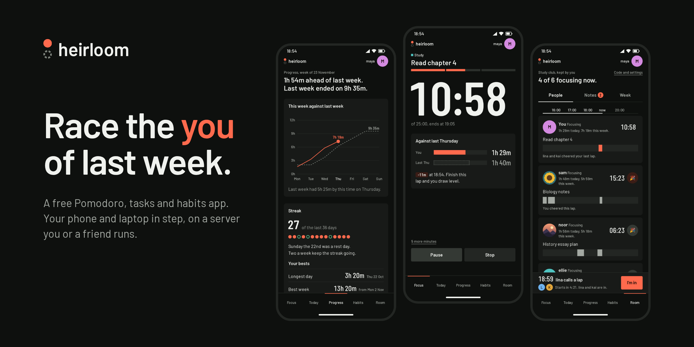
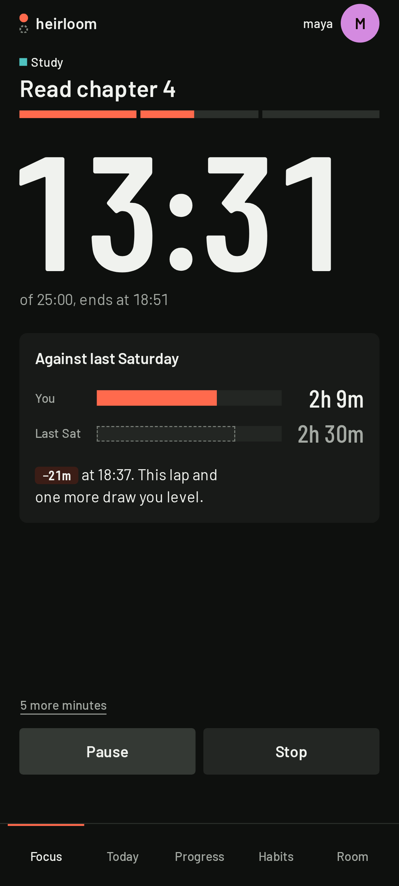
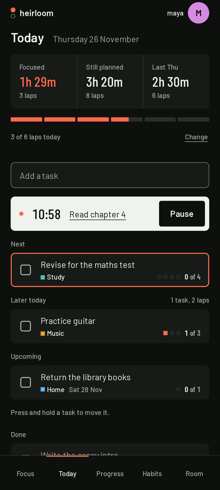
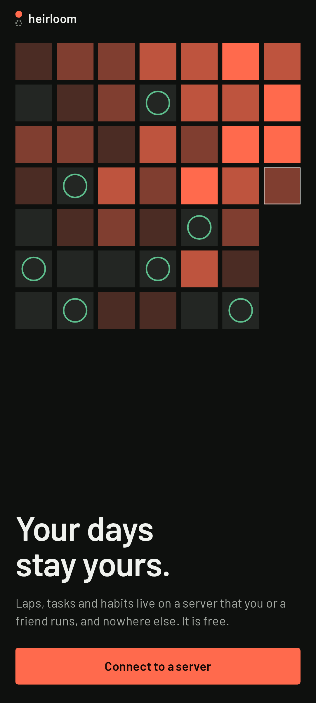

# heirloom

A free Pomodoro, tasks and habits app. You work in laps of focus with last week's same day running
beside you, so you always know how today is going. Your phone and your browser stay in step to the
second and keep working offline. Your days live on a server that you or a friend runs, and nowhere
else.

- **Laps** against your own last week, never anyone else.
- **Tasks** that count in laps, and **habits** with reminders on the days you choose.
- **A streak that forgives:** two rest days a week never break it.
- **Rooms** of up to 16 friends: who is on a lap, a cheer, a lap started together. Nobody is ranked.
- **A bell that rings** on the phone with the screen off, and in a closed browser tab.

## Get started

1. Open the invite link a friend gave you, and pick a username and a password.
2. Install the APK from the [latest release](https://github.com/ravindu644/heirloom/releases/latest)
   on your phone (Android 7 or newer) and paste the same link, or the server's address, to sign in.
   Allow notifications, or the bell cannot ring with the screen off.
3. To study with friends, open **Room** and type the room's code.

No friend with a server? [Run your own](docs/DEPLOY.md): one file for Linux, x86_64 or arm64.

## Screenshots

<table>
  <tr>
    <td width="33%" align="center"> Focus</td>
    <td width="33%" align="center"> Today</td>
    <td width="33%" align="center"> Progress</td>
  </tr>
  <tr>
    <td width="33%" align="center"> Habits</td>
    <td width="33%" align="center"> Room</td>
    <td width="33%" align="center"> Welcome</td>
  </tr>
</table>

> [!WARNING]
> Whoever runs the server can read what is on it: nothing is encrypted for you alone. Use a server
> run by you or by someone you trust, over https.

## Documentation

| Page | What it covers |
|------|----------------|
| [Running a server](docs/DEPLOY.md) | Getting heirloomd, the systemd service, the first setup, https, backups. |
| [Product](docs/PRODUCT.md) | What version 1 does, and why. |
| [Architecture](docs/ARCHITECTURE.md) | How it is built, and what happens when two offline devices disagree. |
| [How it is built](AGENTS.md) | Building from source, and the team of agents that builds it. |

## License

[GNU General Public License v3.0](./LICENSE). Copyright (C) 2026 [ravindu644](https://github.com/ravindu644).
Built with [Preact](https://preactjs.com/), [Capacitor](https://capacitorjs.com/),
[SQLite](https://sqlite.org/) and the [Barlow](https://fonts.google.com/specimen/Barlow) faces
([OFL 1.1](https://scripts.sil.org/OFL)).
