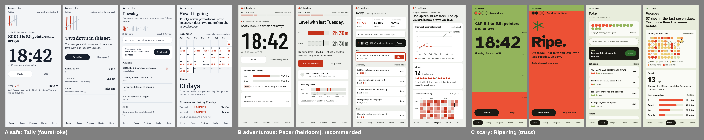
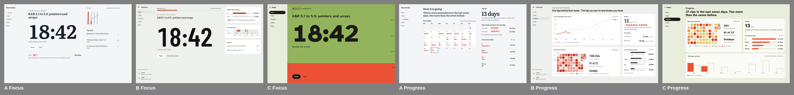

# Design

Three directions for heirloom's design language. One becomes the root `DESIGN.md`; the other two
stay here as the record of what was considered.

**To look at them:** open [index.html](index.html) in a browser (`xdg-open design/index.html`). Pick a
direction at the top, then phone or laptop, light or dark. Click a screen to see it full size. Or
read each direction's README below, which has its reasoning and every screen inline.

| | Direction | The idea | Screens drawn |
|---|---|---|---|
| A | [Tally](routes/a-tally/README.md) (safe) | Four pomodoros are four tally strokes; the long break strikes through them. Book serif, hand-drawn marks | Focus, done, Today, Progress; light |
| B | [Pacer](routes/b-pacer/README.md) (adventurous, recommended) | Your past records are a grey ghost running beside you. A pomodoro is a lap, the day a race against your usual day | All six screens; light and dark |
| C | [Ripening](routes/c-ripening/README.md) (scary) | The focus screen fills from green to tomato red as the pomodoro ripens | Focus, done, Today, Progress; light |

All three at a glance:

## What is in here

| Path | What |
|---|---|
| `index.html` | The gallery |
| `routes/<route>/README.md` | The idea, what it takes from each reference, type, palette, motion, the reward moment, the voice, and the screens |
| `routes/<route>/DESIGN.md` | That direction's tokens in Google Labs DESIGN.md format (lints with 0 errors) |
| `routes/<route>/screens/` | The mockups as HTML and rendered PNGs (412x915 phone, 1440x900 laptop) |
| `ideas.md` | The ten idea sentences the three routes were picked from |
| `names.md` | Name candidates, checked against GitHub and the Play Store |
| `fonts/` | The open-licensed fonts (OFL), with their licences |
| `shared/` | Sample data, the screen shell and the render script the mockups use |
| `refs/` | Reference screenshots of Anthropic, Pomodoist and Focus To-Do. Other people's work: kept locally, never committed. `refs/README.md` says what we took and avoided |

The mockups use invented names, tasks and times from `shared/data.js`.
