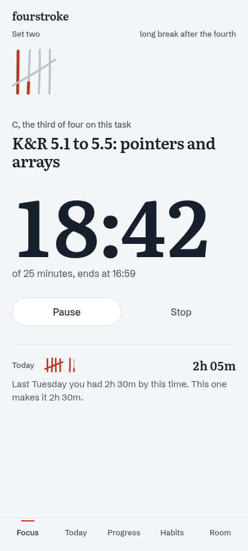
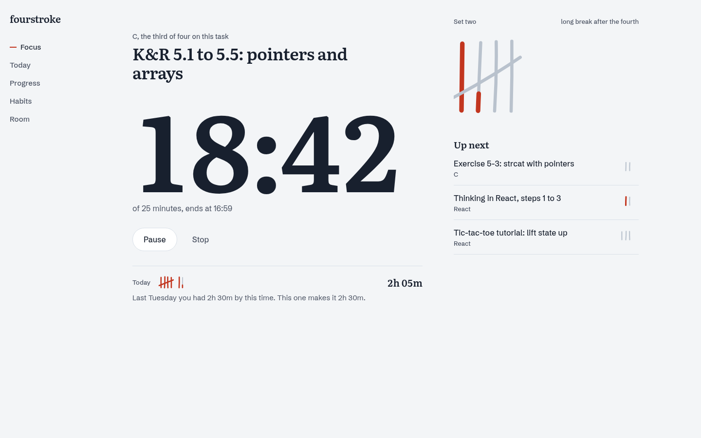
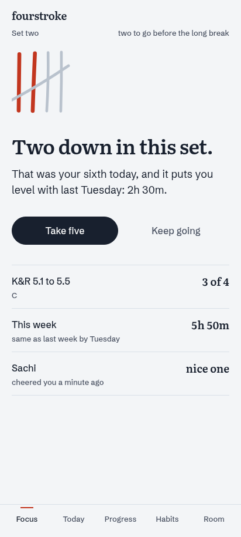
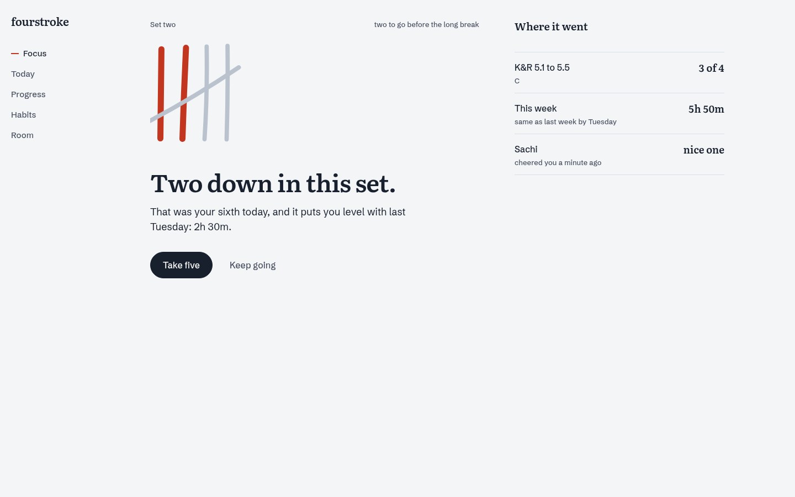
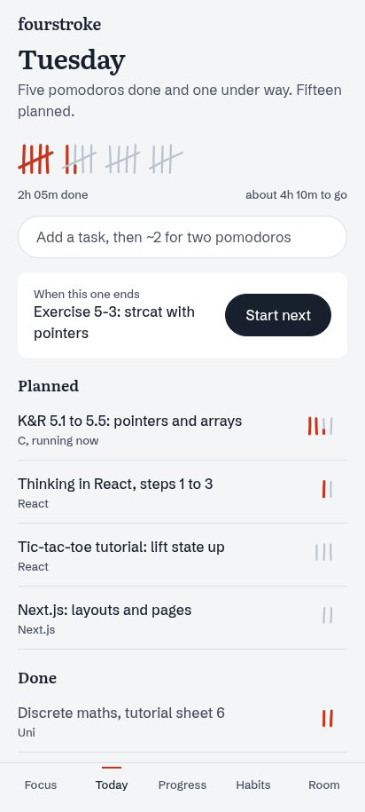
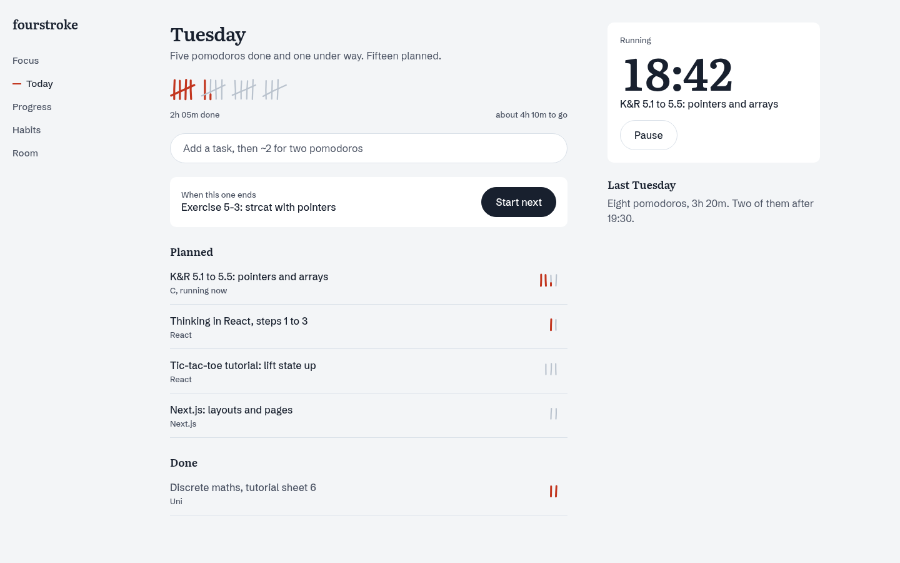
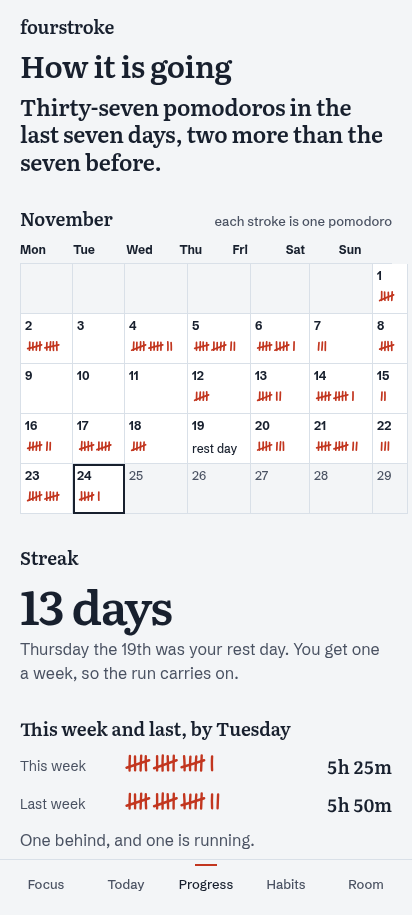
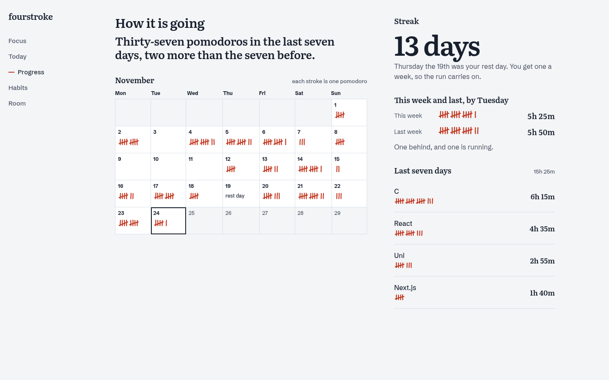

# A. Tally (safe)

**Idea.** The tally gate a student scratches on a desk (four strokes, one across) becomes the
pomodoro set: four pomodoros, and the long break strikes through them. Every count in the app is
written in strokes. A gate counts four, not five: the slash is the break, not a fifth pomodoro.

Method: borrowed format, drawn as pen strokes on a quiet, type-led page. This is the safe route,
the best version of what they expect (timer, list, stats).

Working name on the screens: **fourstroke**.

## What it takes from each reference

- **Focus To-Do:** counts you can see under each task (its red dots become strokes), and a
  calendar of your own days (its goal calendar becomes November written in tallies).
- **Pomodoist:** the calm list, the four-part set indicator, one red.
- **Anthropic:** the most of the three. A serif for headings and the clock, long plain sentences
  set large ("Thirty-seven pomodoros in the last seven days, two more than the seven before."), a
  near-black pill button, and one hand-made mark, drawn for this subject.

## Type

Literata 600 (clock and headings; a book face with tabular lining figures, so the clock reads like
a page number) and Schibsted Grotesk 400/500/700 for UI. Files: literata-400/600.woff2 20 KB and
22 KB, schibsted-grotesk-400/500/700.woff2 24 to 25 KB each, latin subset, OFL 1.1. About 115 KB.

## Palette roles

Ground #F3F5F7, the blue-grey of exercise-book paper (not cream). Ink #18202E ballpoint blue-black,
also the primary button. Stroke #C2361F for strokes you earned; pencil #B9C2CD for planned strokes
and the slash before the long break. Rules #D9E0E8 are notebook lines under rows, not card borders.
Dark: #121519 ground, #F0664D strokes.

## Shape and density

Full-pill buttons, ruled rows rather than cards, generous air (a 48px laptop gutter, a 1040px
column). Strokes are generated pen lines with round ends, a small lean and bend from a seed.

## Motion

| Event | Duration |
|---|---|
| hover, press | 120ms |
| a stroke inks in when a pomodoro is counted | 180ms |
| the running stroke grows | once a minute, no per-frame animation |
| rows, sheets | 160 to 200ms, ease-out |
| **long break** (milestone) | the slash draws across the gate, 600ms, tap to skip |

## The reward moment

The stroke you were writing for 25 minutes is finished in red, and the page says so in a sentence:
"Two down in this set." Then the day's count, the week against last week, and a friend's cheer as
quiet rows. "Take five" is the one button.

## Voice

A friend keeping your score in the margin of your notebook. Numbers in words when they are small.

1. "Two down in this set."
2. "Five pomodoros done and one under way. Fifteen planned."
3. "Last Tuesday you had 2h 30m by this time. This one makes it 2h 30m."
4. "Thursday the 19th was your rest day. You get one a week, so the run carries on."
5. "Add a task, then ~2 for two pomodoros"

## Slop gate, per screen

| Screen | The default | What replaced it |
|---|---|---|
| Focus | ring timer | a gate whose second stroke grows with the minutes, and a serif clock |
| Done | confetti | the stroke finished, one sentence |
| Today | checkboxes and estimate chips | strokes per task: pencil planned, ink done |
| Progress | GitHub-green heatmap | November as a paper calendar with each day written in tallies |

## Scores

Idea 7 (a real fit with the set of four, but tallies are a known way to count), craft 8 (the
strokes hold up at 100%; the laptop Focus screen is sparse), fit 8 (the stroke-growing timer is
harder to read from across a desk than the digits, so the digits stay the boss), distinct 6. About 7.4.

## What may travel

The tally strokes are an option-level detail: they could replace the lap squares in B's task rows.

## Screens

Open `../../index.html` in a browser to flip between sizes and themes.

### Focus (running)

### Pomodoro done

### Today

### Progress

