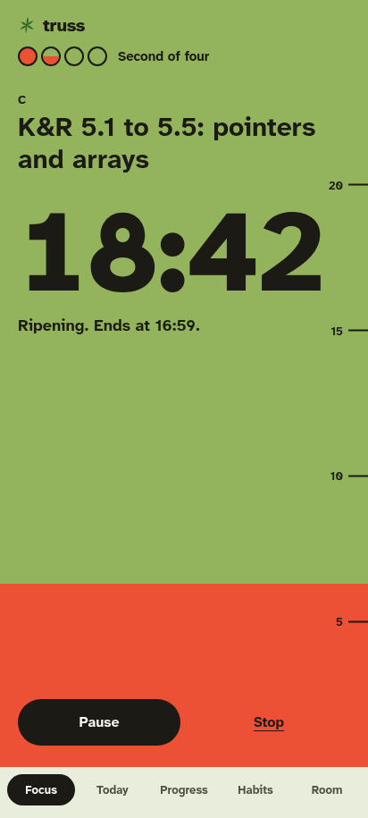
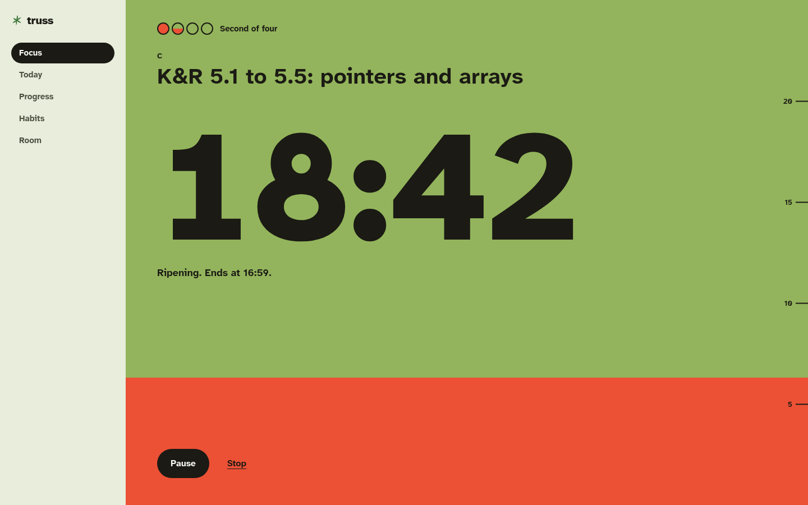
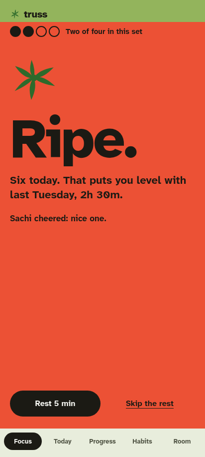
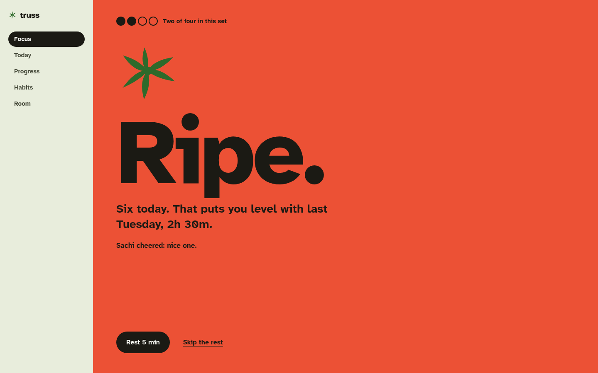
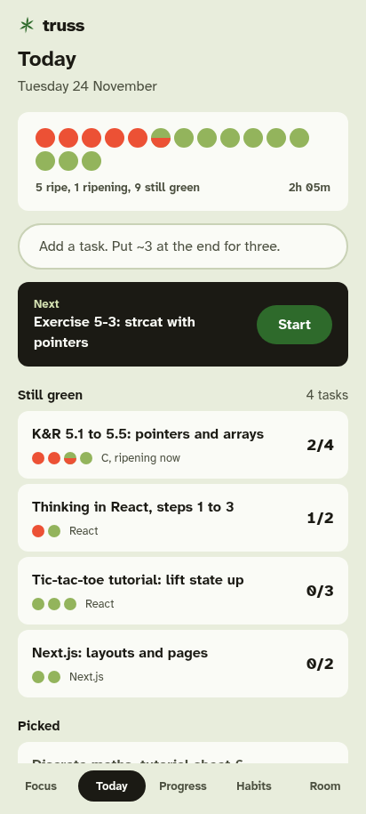
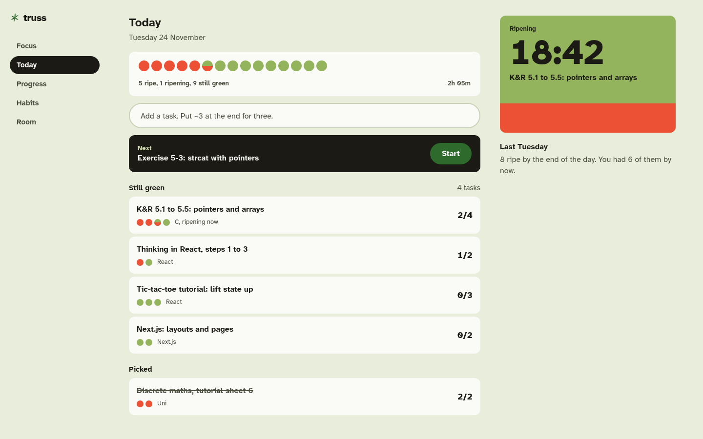
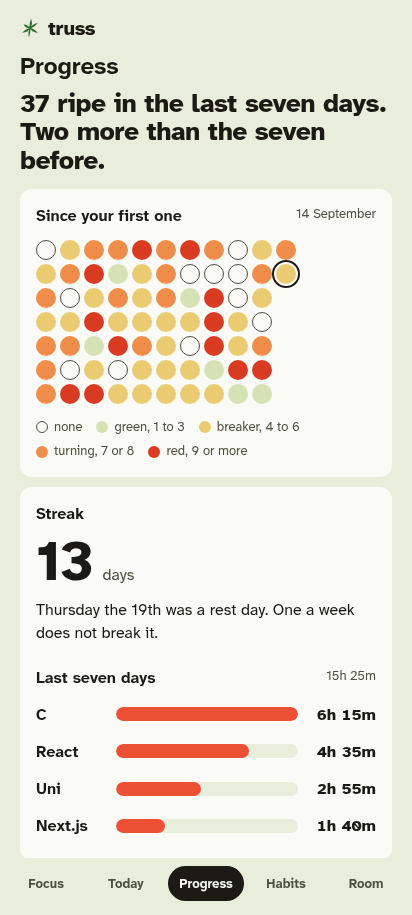
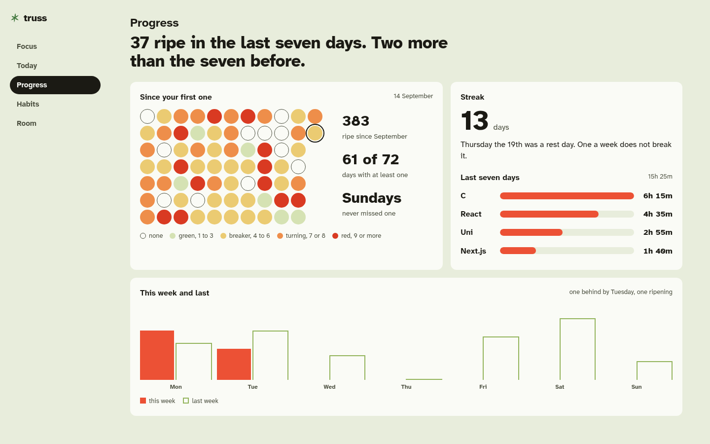

# C. Ripening (scary)

**Idea.** A pomodoro ripens. The Focus screen is one flat field of unripe green, and tomato red
rises from the bottom over the 25 minutes like a level in a jug. From across the room you read how
red it is, not the digits. Every other count uses a grower's ripening stages: green, breaker,
turning, red.

Method: extreme situation, drawn as flat screen-printed fields in three inks with one cut shape,
the calyx (the green star on top of a tomato).

Working name on the screens: **truss** (a cluster of tomatoes that ripen on one stem: the study group).

## What it takes from each reference

- **Focus To-Do:** the red tomato identity taken literally, and its round red dots under tasks,
  which become fruit: red when done, green when planned, half red while running.
- **Pomodoist:** almost nothing visually. Its rule that completion is the one expressive exception.
- **Anthropic:** one bold, simple idea carried everywhere, plain words ("Ripe."), and a friendly
  face that is drawn, not glossy.

## Type

Atkinson Hyperlegible Next 400/700/800, one family. Drawn for low-vision readers, with digits that
cannot be confused, which suits a clock read from across a room. Files: 12 to 13 KB each, latin
subset, OFL 1.1. About 37 KB, the lightest of the three.

## Palette roles

Unripe #93B45C and ripe #EC5135 are the two fields; ink #1B1A14 reads on both (7.4:1 and 4.8:1),
so the clock never changes colour. Calyx #2E6A2B for the star, Start and breaks. Ground #E8EDDC, the
pale underside of a leaf, and paper #FAFBF6 rows. Ripening stages for the heatmap step in lightness
as well as hue (#D5E2B3, #EBCB72, #EE8E4A, #D93A22), so they read without colour vision. Light only
in this round; dark would dim both fields to keep the level visible at night.

## Shape and density

Circles for pomodoros (they are fruit), full pills, 12px rows, low density, big type.

## Motion

| Event | Duration |
|---|---|
| the red level | moves every 15 seconds, 200ms ease-out, never a shimmer |
| buttons, rows | 120 to 180ms |
| **ripe** | the last green goes, the calyx stamps in (120ms, scale 0.9 to 1), then the words: 900ms, tap to skip |
| **set done** | four fruit turn red one by one, 1.2s, skippable |

## The reward moment

The whole screen is red, the calyx lands on it, and one word: "Ripe." Then "Six today. That puts
you level with last Tuesday, 2h 30m." Loud on purpose: the only full-screen moment in the app.

## Voice

Short, warm, a bit of the allotment. The fruit metaphor lives in a few nouns (ripe, still green,
picked) and never in jokes.

1. "Ripening. Ends at 16:59."
2. "Ripe."
3. "5 ripe, 1 ripening, 9 still green"
4. "Thursday the 19th was a rest day. One a week does not break it."
5. "37 ripe in the last seven days. Two more than the seven before."

## Slop gate, per screen

| Screen | The default | What replaced it |
|---|---|---|
| Focus | ring timer on dark | the whole screen is the timer: a level of red with five-minute ticks |
| Done | confetti and a mascot | a flat red field and a hand-cut calyx |
| Today | checkboxes | fruit in two states and a half |
| Progress | green-to-dark-green heatmap | the grower's ripening stages as the scale |

## Scores

Idea 8 (the most memorable, and it reads across a room), craft 7 (the fields are strong; the list
screens are plainer than the Focus screen), fit 6 (red-green and red-as-danger are real risks; a
full-screen saturated field at 2 a.m. is harsh), distinct 9. About 7.6.

## Risks

Colour blindness (deuteranopia makes the two fields close in hue; they differ in lightness, and the
state is always written). Night use needs a dimmed field. Red usually means error elsewhere.

## Screens

Open `../../index.html` in a browser to flip between sizes and themes.

### Focus (running)

### Pomodoro done

### Today

### Progress

